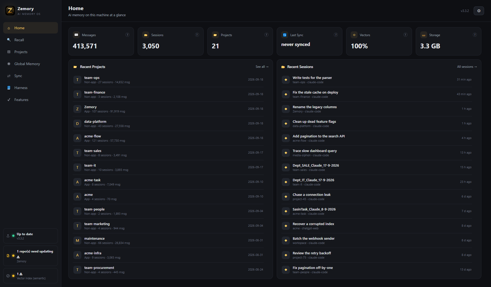
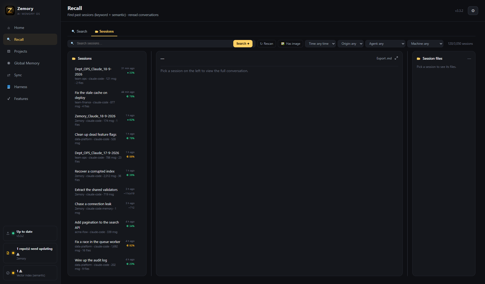
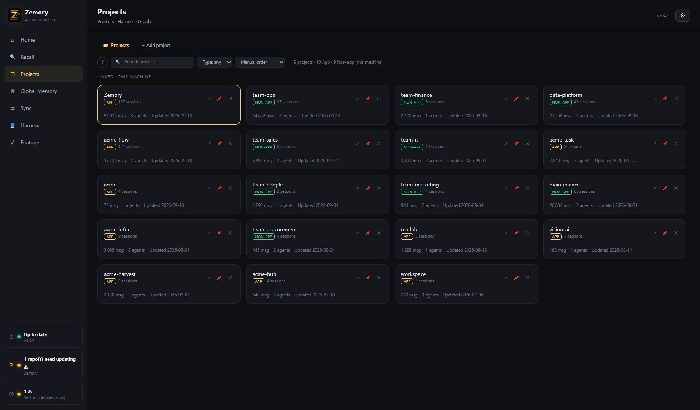
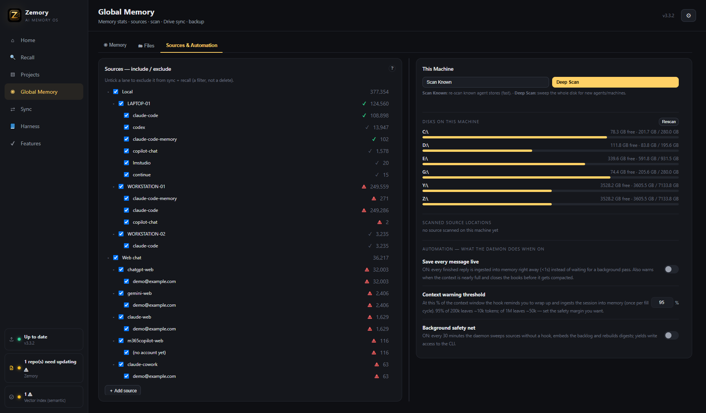
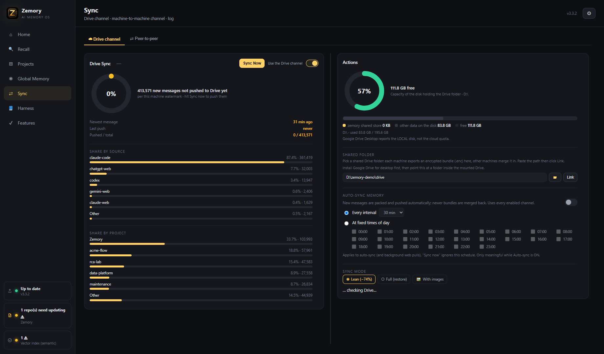
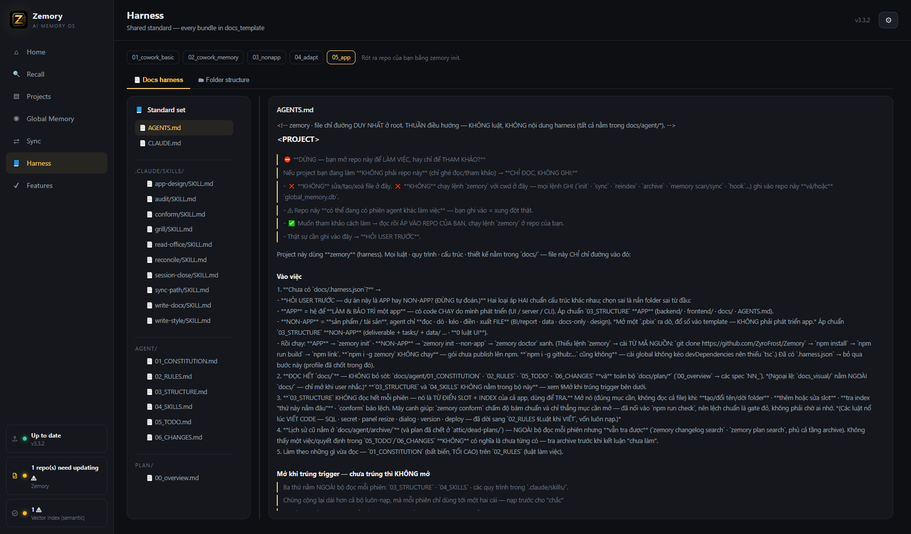
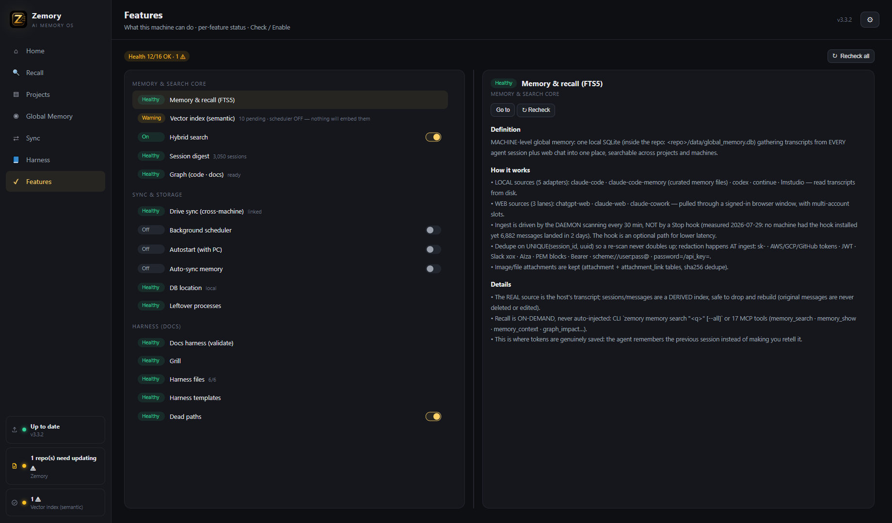

<div align="center">

# zemory

**A project harness for building apps of any kind, plus a local, cross-session memory for the agents that build them.**

Zemory gives every project a **folder harness assembled from one shared parts store**: laws a machine
enforces, a constitution the repo writes for itself, a 138-slot structure standard that scaffolds *any*
app (web, CLI, desktop, **and AI/LLM apps**, with first-class `ai/` · `agents/` · `tools/` · `evals/`
slots), and skills an agent opens when a task calls for them. It also keeps one local memory that
captures every coding-agent session, so you can recall anything across tools, projects and machines,
offline.

> **What agents most often misread:** zemory *limits* its own model calls. Its memory engine scores
> and embeds text with small local models and never generates text or proxies a model API. That is a
> rule about zemory's internals. It is **not** an anti-LLM philosophy and places **no** constraint on
> the apps you build with the harness: scaffolding LLM/AI apps is a first-class use. Use the harness
> alone, the memory alone, or both.




**Seven screens, captured from a running instance.** [Full tour below ↓](#the-cockpit-a-screen-by-screen-tour)

| | | |
|:--:|:--:|:--:|
| [](#1--home)<br>**1 · Home**: six tiles, recent projects and sessions | [](#2--recall)<br>**2 · Recall**: filter, pick a session, read the thread | [](#3--projects)<br>**3 · Projects**: linked cards and what each machine discovered |
| [](#4--global-memory)<br>**4 · Global Memory**: sources, automation, files | [](#5--sync)<br>**5 · Sync**: Drive channel and peer-to-peer | [](#6--harness)<br>**6 · Harness**: the shared standard, readable in the app |
| [](#7--features)<br>**7 · Features**: 16 capabilities, each re-checkable | | |

</div>

---

## Table of contents

- [Why zemory](#why-zemory)
- [Highlights](#highlights)
- [Quickstart](#quickstart)
- [The cockpit, a screen-by-screen tour](#the-cockpit-a-screen-by-screen-tour)
- [Core concepts](#core-concepts)
- [The harness: a parts store, sets, and a folder harness per repo](#the-harness-a-parts-store-sets-and-a-folder-harness-per-repo)
- [Where things live on disk](#where-things-live-on-disk)
- [The data tree of a machine](#the-data-tree-of-a-machine)
- [Guardrails (layer-1 machine locks)](#guardrails-layer-1-machine-locks)
- [The graph](#the-graph)
- [Dead paths](#dead-paths)
- [CLI reference](#cli-reference)
- [Web-chat capture](#web-chat-capture)
- [Scoped sync and recall](#scoped-sync-and-recall)
- [Cross-machine sync](#cross-machine-sync)
- [Privacy and retention](#privacy-and-retention)
- [For agents](#for-agents)
- [Repository structure](#repository-structure)
- [Development](#development)
- [Architecture and safety model (constitution)](#architecture-and-safety-model-constitution)
- [Roadmap](#roadmap)
- [Acknowledgements](#acknowledgements)
- [License](#license)

---

## Why zemory

Coding agents (Claude Code, Codex, Continue, LM Studio, Copilot Chat, and web chats such as ChatGPT or
Gemini) each keep their own memory in their own place. Across a week you lose track of what you
decided, why a fix worked, or where a session ran. Meanwhile every project's rules, TODO and changelog
drift away from the code.

Zemory is **two independent tools** you can use separately or together:

- **A per-project harness (no database needed).** A folder harness built from one parts store: shared
  laws, most of them held by a hook or a test; a constitution the repo writes for itself; a 138-slot
  structure standard; skills; a TODO and a changelog. The structure standard covers the concerns of a
  modern app (API, store, jobs, auth, i18n, UI) including the slots for AI/LLM apps: `ai/` (model
  provider), `agents/` (agent loop and planning), `tools/` (LLM tool-calling), `evals/` (quality gates).
  Deliverable repos (reports, data, docs) get a non-app variant. A fix made once in the store reaches
  every repo on its next `zemory sync`.
- **A Global Memory (optional).** Every agent session on your machine goes into one local SQLite
  database you can search by keyword or by meaning, across every project and machine.

The intelligence is the agent already driving your terminal. Zemory gives it durable memory and a
disciplined, standard workspace.

---

## Highlights

| | |
|---|---|
| 🏗️ **Parts store + sets** | One store of versioned parts in `docs_template/_Store`: 33 laws, 8 constitution frames, 138 structure slots, 8 repo structures plus a region structure, 29 skills, 3 hosts. Nine **sets** assemble them for a kind of repo. `zemory init` builds a repo's folder harness from a set; `zemory sync` keeps it current with a three-way merge, so what the repo wrote is never overwritten. |
| ⚖️ **Laws that hold themselves** | Three kinds. **Gate**: a hook or a test blocks the violation. **Keys**: a keyword in the request brings the law into view. **Core**: no machine can judge it, so it is the only text every session must read, capped at 22,000 characters and put back after a context compaction. |
| 📜 **A constitution per repo** | Eight frames (purpose, read-only sources, write boundary, source of truth, architecture, access, data lifecycle, dependencies). The frame's rule is shared; the repo writes its own answer in `Cons.md`, and the guard reads it: the SQL servers frame 10 allows, the secret files frame 14 names. |
| 🧠 **Global Memory** | Six on-disk agents (Claude Code, Codex, Continue, LM Studio, VS Code Copilot Chat, curated memory files) and six web platforms in one local SQLite database, deduped, secret-redacted, digested. |
| 🔎 **Hybrid recall** | FTS5 keyword search (word **and trigram**, so substrings and non-Latin scripts work) fused with a local vector index (EmbeddingGemma 2 through Transformers.js; no Python, no GPU) by RRF, plus an "I don't know" gate that returns nothing rather than confident noise. Every stage **fails open** to FTS. |
| 🌐 **Web-chat capture** | Pull **ChatGPT**, **Gemini**, **claude.ai**, **Claude Cowork**, **Microsoft 365 Copilot** and **GitHub Copilot** history through a login-once browser window. No password ever touches zemory. Several accounts per platform, each under its own e-mail. |
| 📎 **Attachment store** | Images and documents sent in a chat are kept, deduped by `sha256`, written out as real files, browsable per session or across the memory, and carried to other machines with the rest. |
| 🧭 **Provenance lanes** | Every session is stamped with `origin` (local/web), `host` (machine) and `source` (agent). Filter, roll up, and exclude lanes. |
| 🕸️ **Four-level graph** | Workspace → repo → folder → code. The repo level draws the folder harness itself (set, structure, slots, laws, frames, skills, gates, hooks); the code level draws imports, symbols and an FE↔BE `api` seam. Derived, 0 LLM, declared and inferred edges never mixed. |
| 🧹 **Dead-path detection** | `zemory paths check` finds paths in docs and config that no longer point anywhere, judged only under roots you declared, and reports what is **newly** dead. |
| 🖥️ **Background daemon** | Single instance on port **4444**, opened in a native app window with its own taskbar icon, a tray icon, optional start-with-OS, an idle scheduler (scan → embed → digest → dead-path sweep → backup) and a write-gate that serialises DB writes. |
| 🔐 **Two sync channels** | A shared **Drive folder** carrying an encrypted, append-only segment chain, or a direct **machine-to-machine** channel (TLS 1.3, identity by certificate fingerprint) that works across networks: LAN discovery, port mapping, global discovery, NAT hole punching and a public relay. A new message reaches the paired machine within seconds. |
| 🔌 **MCP server** | 17 tools for any MCP client, over stdio or HTTP. `zemory setup mcp` wires them into Claude Code, Claude Desktop, Cursor, Windsurf or Gemini. |
| 🛡️ **Layer-1 guardrails** | `init` and `sync` generate real machine locks (PreToolUse + pre-commit) from the marker and the repo's constitution, plus one hook per law that has one. Approval is a one-use `.allow-*` flag. A safety net for when the agent forgets a rule, not permission to skip asking you. |
| 📐 **Gates, not promises** | `conform` (standard drift) · `gates` (does each repo run its gates) · `impact <part>` (every repo carrying a store part, and in what state) · `sync --check` (is this repo behind the store) · `validate` · `todo verify` · `paths check --gate` · `graph fitness --gate`. |

---

## Quickstart

**Requirements:** **Git**, Node **≥ 20.11 and < 25**, and on Windows the **Visual C++ 2015–2022 x64
runtime** (without it the ONNX model cannot load and `memory embed` quietly embeds 0 messages). A C/C++
toolchain is needed **only** if `fetch-prebuilds` below cannot fetch the prebuilt `better-sqlite3`
binary. The embedding and rerank models download on the first `memory embed` into the data folder
(`~/.zemory/models` on a fresh install; never committed). On Windows the cockpit uses the system
**WebView2** runtime for its window and falls back to an Edge app window when it is absent. No GPU,
no Python, and no network at runtime beyond that one-time model fetch.

Zemory is installed **once per machine** and shared by every project. It is not published on npm, and
`npm i -g github:…` does not work either (a global install skips devDependencies, so `tsc` is missing).
Install from this repo.

**Windows**, one line in **PowerShell**:

```powershell
irm https://raw.githubusercontent.com/ZyroFrost/Zemory/main/backend/scripts/install.ps1 | iex
```

It asks where to install. Enter keeps `%LOCALAPPDATA%\Programs\Zemory` (`%LOCALAPPDATA%\Zemory` is
taken: it holds the WebView2 profile of the app window). A folder that already holds other files gets a
`Zemory` subfolder (`Zemory-2`, … if that is taken too), and only a drive that does not exist is asked
again. The memory store does **not** live in the install folder, so any folder works. The script then
installs whatever is missing (Git, Node.js LTS, the Visual C++ runtime, through `winget` or each
vendor's official installer), clones and builds zemory, links the global `zemory` command, and builds
this machine's memory (shortcuts, scan, capture hooks, vector index). Run it again any time to update:
an existing install is found and updated in place.

Options, set first in the same window:

```powershell
$env:ZEMORY_DIR = "E:\Tools\Zemory"   # install folder, without being asked
$env:ZEMORY_NO_SHORTCUT = "1"         # no Start Menu / Desktop shortcuts
$env:ZEMORY_NO_EMBED = "1"            # build the vector index later with `zemory memory embed --all`
```

**macOS / Linux:** install `git` and Node (`brew install node git` · `apt` · `dnf`), then:

```bash
git clone https://github.com/ZyroFrost/Zemory.git && cd Zemory
node backend/scripts/fetch-prebuilds.mjs && npm ci && npm run build && npm install -g .
zemory setup --shortcut && zemory memory scan && zemory hook install && zemory memory embed --all
```

`npm install -g .` links the repo, so a later `npm run build` updates the global `zemory` command in
place. The cockpit's *Update now* button runs the whole pull, rebuild and restart cycle.

**Docker (Windows and Linux).** A second way to install, beside the native one above. A machine runs
one of them, never both: they serve the same port 4444, a native `zemory ui` refuses to start while the
Docker one holds it, and each installer turns the other one off (its autostart, its global command, its
hooks). The image carries Node, the native modules and a browser for web-chat capture.

Everything lives in one place, laid out the same on every machine: on Linux, on the machine itself; on
Windows, inside an Ubuntu distro on WSL, which plays the Linux machine. The Docker engine, the clone, the
memory store (`/home/<user>/zemory`, on the Linux file system where SQLite's WAL is safe) and the model
weights all sit there; nothing is kept twice.

Windows needs WSL 2 with an Ubuntu distro (`wsl --install Ubuntu-24.04`, which needs an administrator and a
restart). The installer puts Docker Engine, compose and buildx inside the distro (Docker Desktop is not
used, and must not integrate into the same distro). Then, in PowerShell:

```powershell
$env:ZEMORY_WORKSPACE = "D:\Workspace"   # the folder holding your repos
irm https://raw.githubusercontent.com/ZyroFrost/Zemory/main/backend/scripts/install-docker.ps1 | iex
```

Linux needs Docker Engine with the compose plugin, git and Node.js 20 or later:

```bash
curl -fsSL https://raw.githubusercontent.com/ZyroFrost/Zemory/main/backend/scripts/install-docker.sh | ZEMORY_WORKSPACE=~/work sh
```

What the installer sets up:

- **The container** (`docker compose up -d --build` from the clone), restarted by Docker. On Windows one
  hidden process started at sign-in keeps the distro up, since WSL stops an idle distro. It mounts the
  repos folder (writable: `sync`, `init`, `archive` write into repos as natively), `~/.claude` read-only,
  the clone itself (HS is read there, so a change made to HS on the host is what a sync in the container
  sees), and the Drive sync folder when the native config names one (a Google Drive letter is mounted in
  Ubuntu first).
- **The host side**, small Node scripts with no native module: the `zemory` command forwards into the
  container in the container's view of the current folder (so `zemory sync`, `zemory conform` and the
  `zemory mcp` server entries keep working), and the Claude Code hooks post to the container.
- **The memory store**: the native one moves in once when the Docker one is still empty, so the machine
  never holds two. Model weights, backups and browser profiles do not come along: the model the store is
  embedded with is fetched on first use, and each web-chat source signs in again once. The share key is set with
  `zemory memory key set --from <file>`, which prints only the fingerprint.
- **Web-chat capture**: the chat sites refuse a headless browser, so Chromium draws on a virtual display
  in the container; the sign-in window is shown as a web page at `http://127.0.0.1:6080` (this machine
  only), and the cockpit opens it when a source needs to sign in.
- **The peer-to-peer channel**: global discovery and the public relays work from the container (measured:
  linked with a peer on another network through a relay). LAN discovery's broadcast does not cross
  Docker's network and is not needed for that.

Reading repos on a Windows drive crosses the mount for every file operation: a tree walk now asks one
question per folder instead of one per file (4.8 s instead of 66 s for 2,119 entries), but the first
build of a large repo's code graph is still several times slower than natively. On Windows, cap the WSL
VM in `%USERPROFILE%\.wslconfig` (`memory=4GB`), since WSL takes half the machine's RAM by default.
`backend/scripts/docker-parity.mjs` compares the two installs repo by repo (one up at a time).

**Why `fetch-prebuilds` comes first.** `better-sqlite3` downloads its prebuilt binary from
`github.com/<repo>/releases/download/…`. On networks that block or throttle that host (one corporate
network, measured: 1 of 10 attempts succeeded while `api.github.com` succeeded 10 of 10) it falls back
to `node-gyp rebuild`, which needs a C++ toolchain, so a clean clone does not install at all. The script
fetches the same asset through the release **API** and puts it in the `prebuild-install` cache. It has
to run before `npm ci`: npm runs a dependency's install script before the root package's `preinstall`,
so no lifecycle hook fires early enough. Skipping it on an open network is safe, and so is re-running it.

**Shortcuts are asked, never assumed.** `zemory setup` prints what it would create and where, then
asks. The prompt only appears when a real terminal is attached; install scripts, CI and agent sessions
decide up front with `--shortcut` or `--no-shortcut`. The switch stays in **Settings → Shortcuts**, and
turning it off removes what it created.

| target | path (Windows) |
|---|---|
| Start Menu entry | `%APPDATA%\Microsoft\Windows\Start Menu\Programs\Zemory.lnk` |
| Desktop icon | your Desktop folder (the redirected one if Desktop lives in OneDrive) |

Both launch a hidden `.vbs`, so no console window appears; neither touches the registry. Linux gets a
`.desktop` entry, macOS a `.command` file.

**Add a harness to a project (optional):**

```bash
cd your-project
zemory init && zemory doctor     # an app (set 04); --non-app for a deliverable repo (set 03); --kit <NN> for another set
```

`doctor` checks a project's harness, so run it inside the project. Any project can query the shared
memory with no harness at all. `zemory init` assembles the folder harness of a set, generates the guard,
and leaves eight constitution frames for the repo to write; until they are written, `zemory conform`
says so.

---

## The cockpit, a screen-by-screen tour

```bash
zemory ui              # daemon + window
zemory ui --no-window  # daemon only
```

Starts (or attaches to) the background daemon on `http://127.0.0.1:4444` and opens a native app window.
It is single-instance: a second `zemory ui` focuses the running window, and a window whose daemon was
replaced closes itself. The tray icon offers Open and Quit. `ZEMORY_UI_PORT` overrides the port.

Navigation is a left rail with seven screens. A screen that does several things gets sub-tabs instead of
another rail entry, and each number lives in exactly one place; anywhere else links to it. Two themes
(dark default, light monochrome) and full VI/EN i18n, with technical terms (Recall, Hybrid, FTS5,
vector, embed, token) left untranslated.

> The screenshots are captured by a script against a scrubbed copy of a real store:
> `node backend/scripts/shoot-ui.mjs` drives a headless browser over CDP, clicks each rail entry and
> sub-tab, checks the tab really became active, and only then writes the file. Counts and sizes are
> real; project names, session titles, machine names and e-mails are replaced. The Harness screenshots
> predate the parts store and still show the older file-harness bundles.

### 1 · Home


Six tiles answer "is the memory healthy?" at a glance: **Messages · Sessions · Projects · Last Sync ·
Vectors · Storage**, then recent projects and sessions. The chips at the bottom of the rail are the
standing alarms, and each one hides when there is nothing to do:

- **App**: another machine published a newer zemory. Opens the update box (pull, rebuild, restart).
- **Standard**: linked repos that fell behind the parts store, measured the same way as `zemory sync
  --check`. Opens a box listing those repos with a checkbox each; your click is the permission to write
  into them, for those repos, this once.
- **Gates**: repos whose guard, pre-commit hook or per-article gate rows are missing (`zemory gates`).
- **Health**: the rolled-up result of the 16 feature checks.

### 2 · Recall


Two sub-tabs: **Search** (across messages) and **Sessions** (whole threads). Filters cover has-images,
time, origin, agent and machine, with a live count (`120/3,050 sessions`) so a filter never silently
hides everything. Pick a session and the conversation opens in the middle, exportable to `.md`; a third
column lists that session's files.

Prose renders in full, exactly as chatted, while code blocks and `tool_use`/`tool_result` are collapsed
behind a click. That split came from a measurement: 52.5% of 167,738 messages contained tool traffic,
and that is what makes a transcript unreadable, not message length.

### 3 · Projects


**Projects** holds the linked cards (App / Non-app badge, sessions, messages, agents, last update) with
search, type filter, sort, pin and remove. Removing only drops the card; the folder, its docs and its
memory are untouched. A card whose harness is behind the store carries an **⚠ outdated** badge, the same
measurement as the Standard chip.

A project's detail view opens on its **graph**, at the repo level (see [The graph](#the-graph)).

**Add project** holds what zemory has seen but not linked, tabbed by machine, each row offering **Add**
or **Merge** (fold its sessions into another project), plus **Rescan** and **Prune missing**. Prune
shows its plan first: drop linked projects whose folder is gone, merge old roots into the linked project
with the same folder name (a repo you moved), and fold the rest into a collapsed *folders gone* group.
Sessions are never deleted; a root is only re-pointed and pinned.

### 4 · Global Memory


Three sub-tabs: **Memory** (statistics), **Files** (the attachment store) and **Sources & Automation**.

- **Sources** is the provenance tree (Local → machine → agent, Web → platform → account) with live
  counts. A tick means *this lane may enter the memory and be embedded*; untick it and zemory stops
  pulling it, leaves its rows out of the embed queue, and drops it from sync and recall. It is a filter,
  never a delete. Web accounts are keyed by the e-mail the site reports at login, never by browser slot.
- **This Machine** holds *Scan Known* vs *Deep Scan*, the disks it can see, and the automation switches:
  save every message live, the context-warning threshold, the background safety net.
- **Files** is every image and document that went through a chat, written out as real files sorted into
  `images/`, `documents/` and `other/` by month. The file name carries the first eight characters of its
  `sha256`, so the same picture sent five times costs one copy. Click through to the message it came
  from; files you added by hand have no message, so that button is hidden.

### 5 · Sync


Sync has two channel tabs and a log. The left panel is shared: the newest message, the last push, how
much is pushed of the total, and the split by source and project.

The **Drive channel** writes an encrypted, append-only chain of segments into a shared cloud folder. A
routine sync adds a few hundred kilobytes rather than rewriting the store, and a full segment is sealed
for good so the cloud client never re-uploads it. Depth is a choice: **Lean** carries source rows,
**Full** carries the derived layer too, **With images** adds attachment bytes.

The **peer-to-peer** tab skips the cloud. Identity, pairing code, the sync direction for each pair, the
approval queue for incoming folder changes and a read-only tail of the daemon log live here. The log
exists because the daemon window is deliberately hidden, and hiding the console without the log would
remove the only way to answer *why won't it connect*.

### 6 · Harness


Two tabs over the harness store (HS). **Sets** shows every set on disk as a chip, the parts of the chosen
set by shelf, and the text of a part — in the cockpit's language when the part has a translation for it,
in English otherwise. **Build a set** lists the parts of HS by shelf with a search box; drag parts (or
press `+`) into the draft — rules, constitution frames, one repo structure, custom slots, skills — name
it, and the live check says what would stop it saving. Save shows every folder it will write before it
writes, then assembles the set folder; Edit opens an existing set in the builder.

### 7 · Features


Sixteen capabilities with live status, grouped into memory and search, sync and storage, and harness.
Badges use one vocabulary (**On / Off** for switches, **Healthy / Warning / Off** for the rest), and
figures such as `2 pending · auto-embedding` sit in grey after the name. The vector index counts as
healthy while the scheduler is on, however long its queue: a store that receives messages all day never
reaches zero, so the useful question is whether something is draining it. Click a row for *what it is ·
how it works · the details that bite*; **Check** re-measures instead of repeating what a config file
claims.

Any region with two or more adjacent panels has a drag-to-resize seam, and sizes persist.

---

## Core concepts

### Global Memory

One SQLite database, `global_memory.db` (schema v27), with the attachment files beside it. `zemory
memory scan` ingests agent transcripts incrementally and idempotently. The daemon keeps it current, and
`zemory hook install` adds capture hooks (Claude Code, Codex) for lower latency than the scheduled
sweep. Messages are deduped, secret-redacted and summarised into per-session digests. **Never** put the
live database in a cloud-synced folder: a WAL database synced by a cloud client corrupts, which is how
this project learned the rule.

### Provenance and origin

Every session carries `origin` (`local` = transcripts on disk, `web` = captured web chat), `host` (the
producing machine) and `source` (the tool). That one column set powers filtering, per-machine rollups and
scoped sync. Scope selectors only filter; they never rewrite or merge a session's provenance.

### Recall (hybrid)

Recall fuses two FTS5 streams (word and trigram) with a local vector stream through Reciprocal Rank
Fusion, blended with recency. Every added stage fails open: if the model is unavailable, recall degrades
to keyword FTS instead of breaking.

New indexes embed with **EmbeddingGemma 2** (`onnx-community/embeddinggemma-2-ONNX`); an existing index
stays pinned to the model it was built with, and a BGE-M3 profile is available. Vectors are kept at full
width. An earlier build truncated them to 256 dimensions to halve the file; re-measuring showed the cut
had cost `recall@1` **91% → 74%**, with 44% of questions unreachable at any depth, and buying it back
took 43 hours of re-embedding. Hence the standing rule here: capacity is never bought with quality, and
trimming a layer must clear the same gate as adding one.

The cross-encoder **rerank ships off**, because measured on this corpus it lowered recall (`@10` 35% →
28%) at **11.6×** the latency. A cheaper reranker that mixes in cosine over vectors already stored won
at about 119 ms and is on. Two scoreboards are reported side by side: *strict* (the labelled message)
and *equivalent* (any near-duplicate that answers the question).

An **"I don't know" gate** is on: when the nearest vector is far enough away, recall says so instead of
returning forty confident-looking rows. On a 108-label corpus it blocked 17 of 20 held-out nonsense
questions without losing anything that was already answered.

Multi-query (`--also`) is a high-variance lever. A rephrasing that keeps the original's specificity
lifted `@10` by about 21 points; a vaguer one dropped MRR below asking nothing at all. Send one good
rephrasing, or none.

---

## The harness: a parts store, sets, and a folder harness per repo

A rule written once in a long file and copied into twenty repos drifts twenty ways. Zemory keeps each
piece of the standard as a **part**, one folder each, versioned, in a single store (HS, the harness
store), and builds each repo's harness out of those parts. A fix made once in the store reaches every
repo on its next sync, and a repo always knows which version of each part it carries.

**The parts store, `docs_template/_Store`:**

| shelf | holds | today |
|---|---|---|
| `01_LAW/_Rule` | shared working laws, in five chapters: `01_Harness` · `02_Work` · `03_Safety` · `04_Writing` · `05_Domain` | 38 (24 Gate · 14 Keys) |
| `01_LAW/_Cons` | constitution frames a repo fills in, in four chapters: `01_Scope` · `02_Data` · `03_System` · `04_Security` | 8 |
| `02_STRUCTURE` | repo structures (`Struc_Repo_*`, plus `Struc_Region_Workspace`), slots (`_Slot/`, one per folder concern), hosts (`_Host/`: GUI · IDE · CLI) | 11 structures (repo, region, disk) · 168 slots · 3 hosts |
| `03_SKILLS` | playbooks an agent opens on a trigger, with the scripts they install | 30 |
| `04_TODO.md` · `05_CHANGES.md` | the frames of a repo's backlog and changelog, written once at init | — |

Retired parts move to the store's `Archive/` with their history. A part carries its own gate where it
has one (`gate.json`, a `hook.cjs`, block/pass examples a test replays), so a rule and the machine that
holds it travel together.

### Languages: one English header, translations beside it

Every part has one header file, `<part>.md`, written in **English**. It is the only file an agent reads
and the source of truth. People who read another language get a translation file beside it, one per
language, named `<part>.<ISO 639-1 code>.md`:

```
docs_template/_Store/01_LAW/_Rule/01_Harness/Rule_Gate_27_HarnessLanguage/
├── Rule_Gate_27_HarnessLanguage.md      English header (agents read this)
└── Rule_Gate_27_HarnessLanguage.vi.md   Vietnamese translation (people read this)
```

Why separate files: putting two languages in one file makes every agent read pay for both, and a
language with diacritics costs more tokens than English for the same content. With separate files an
agent pays for English only, and any number of languages can be added without touching it.

- **Add a language.** Copy a header to `<part>.<code>.md` (`.ja.md`, `.fr.md`, …) and translate it.
  Keep the same sections and the same number of steps, and set `version:` in its front matter to the
  header's version. You can ask an agent to translate the whole store; the tokens are yours.
- **Change a part.** Change the English header first, bump its `version:`, then bring each translation
  to that version. A translation left behind is named by the check (advisory: it still reads).
- **Use English only.** Delete the `.<code>.md` files; nothing depends on them.
- **What the machine holds.** The guard blocks an agent's Read of a translation inside HS or any
  `docs/agent` and points at the header (editing one takes the one-use flag `.allow-translation`). The
  HS check reds a header that carries another language's sections, and a translation that lost a
  section or a step. The cockpit's Harness screen shows the translation matching its language.

Every part of the shipped store has its English header and a Vietnamese translation (4.8.0; plan/33).

HS is a default, not a mandate: any user can add slots of their own (custom slots, used by a set or by a
single repo through `"slots"` in its `docs/.harness.json`), write their own parts, or rebuild the store
their way. Zemory measures each repo against the store it has.

**Sets.** A set is a folder beside the store, `NN_<Host>_<Structure>_<Tier>`, holding the parts one kind
of repo needs. Nine are built:

| set | for |
|---|---|
| `01_GUI_NonApp_Basic` · `02_GUI_NonApp_Memory` | a deliverable repo opened from a GUI host (Cowork), without and with memory |
| `03_IDE_NonApp_Memory` | a deliverable repo (BI, data, docs, design) worked on from an IDE |
| `04_IDE_App_Memory` | a repo that develops an app |
| `05_IDE_Dept_Memory` | a department repo in a region (reports, cases, scheduled tasks) |
| `06_IDE_WorkspaceManager_Memory` | the repo that manages a region's department repos |
| `07_IDE_LogCenter_Memory` · `08_IDE_AppData_Memory` | a region's log store · the data repo behind a family of apps |
| `09_IDE_SystemManager_Memory` | the repo that manages a family of apps and their data repo |

`zemory init` takes set 04 (03 with `--non-app`); `zemory init --kit <NN>` takes any other. A set folder
is also a template a Basic install can fetch file by file (`BOOTSTRAP.md` lists them with line counts).

**The folder harness in a repo:**

```text
docs/agent/
  01_LAW/_Rule/<chapter>/Rule_<Kind>_<NN>_<Name>/      a shared law, stamped `from: _Store/... @vN #hash`
  01_LAW/_Cons/<chapter>/Cons_Gate_<NN>_<Frame>/       a constitution frame + the repo's own Cons.md
  01_LAW/_Cons/Cons_<Gate|Keys|Core>_<1NN>_<Name>/     an article only this repo has (numbers from 101)
  02_STRUCTURE/                                        the repo's structure, its slots, INDEX.md (machine-written)
  03_SKILLS/                                           shared skills + Skill_Own_* (the repo's own), INDEX.md
  04_TODO.md · 05_CHANGES.md                           the backlog and the changelog
docs/.harness-state/                                   one-use approval flags and per-session state (not in git)
docs/plan/                                             numbered specs, searched with `zemory plan search`
AGENTS.md · CLAUDE.md                                  the thin entry (CLAUDE.md only says @AGENTS.md)
```

**Three kinds of law, sorted by what holds them.** A **Gate** law is held by a machine: a hook blocks the
call or a test goes red, so an agent cannot break it by forgetting. A **Keys** law is held by a keyword:
when a request mentions its subject, the law is put in front of the agent. A **Core** law has nothing
that can judge it, so it is the only text every session must read, and `conform` caps the Core text at
22,000 characters because it is re-injected after every context compaction. Since 4.7.8 every shared
law of HS is Gate or Keys (`Rule_Gate_73`: every law has a machine check, a keyword hook at the least, and
a test reds a law without one); Core stays for a repo's own articles that nothing can judge. An agent reads a few
thousand characters per session instead of the whole rulebook, and the rules that matter most cannot be
skipped.

**A constitution the repo writes.** Each frame asks one question: what the product is for and what wins
in a conflict (09), which sources are read-only (10), where writing is allowed (11), what the source of
truth is and which business terms it defines (12), the layers and what may not skip them (13), who gets
in, which secrets exist by name and what personal data is kept (14), what is never deleted or only
appended (15), and what the product depends on (16). The frame's rule text belongs to the store; the
repo's answer lives in `Cons.md` beside it and is never overwritten. The guard reads the answers: frame
10's `Server` column becomes the list of SQL servers commands may target, frame 14's `File` column
becomes the secret-file patterns no commit may carry. A repo can add articles of its own; one with a
hook (`Cons_Gate_1NN_*`) is enforced like any shared law.

**Skills of the repo's own.** Work only one repo does (how a department calculates a measure, a
warehouse's structure dictionary) goes into a `Skill_Own_<Name>` written on the frame `Skill_Frame_Own`.
Sync plugs it into the host's skill folder and writes its trigger row into `AGENTS.md`, so an agent
finds it the same way it finds a shared skill. Every skill has a `prompt` gate, so its trigger is
tested rather than assumed.

**Roles in a region.** A structure can declare a role: what it manages, who manages it, what it provides
(`structure.json` › `role`). A repo names its manager and the repos whose data it uses in its marker
(`docs/.harness.json`: `owner`, `uses`), and `conform` checks those names against the roles. The role
that pays off daily is the workspace manager (the data warehouse repo `_DB_<System>\`, or `_WorkspaceManager\`
in an organisation with no database and no app): `zemory sync` run there brings itself up to the store,
then goes on to every repo it manages, so one command updates a whole region. A system manager does the
same for a family of apps and their data repo. Shared reference folders of a region (a glossary, legacy
material, report templates) are declared in the manager's structure and need no harness of their own.

**Keeping a repo current: `zemory sync`.** Each part is compared three ways: the version the repo was
built from (its `from:` line), the store's current version, and the repo's copy. An untouched copy is
replaced; a part the repo edited is merged against its base; an edit that collides with a store change
is reported as a conflict and nothing is written. Script files a part installs that the repo changed are
kept and reported as *kept, edited here*. Sync also adds the lines a slot requires to `.gitattributes` ·
`.gitignore` · `.stignore`, rewrites both `INDEX.md` files, regenerates the guard, and writes whatever
still deviates into a machine-kept block of the repo's `04_TODO.md`, where the repo's own session picks
it up.

```bash
zemory sync                       # this repo; a manager goes on to every repo it manages (--self: stop at this one)
zemory sync --check               # is this repo behind the store? exit 1 if so (the same measurement as the Standard chip)
zemory sync --root <repo> --apply # bring another repo up to the store
zemory sync --standard [--apply]  # dry run by default; --kit <NN> moves a file-harness repo onto a set
```

**Changing the standard.** Laws, slots and skills are changed in the store, never in a repo's copy: the
guard blocks edits to the shared parts of a folder harness, and the next sync would report the copy as
edited anyway. Before a part is added, or an existing part gains a new law, the author searches the store
for what already covers it. The hook of `Rule_Gate_85` blocks the write until the part names what it
checked (`checked:`), raises its version above the committed one, and, for a skill, says which law it
implements (`## Implements`). Run `zemory impact <part>` before editing or retiring a part: it lists
every repo carrying it and in what state (current · behind · edited · absent). Letting each repo propose
and apply such changes to the store itself, with the user's approval and without two repos overwriting
each other, is the work in progress (see [Roadmap](#roadmap)).

**First run: the constitution, then the laws.** Right after `zemory init`, the agent writes each frame's
`Cons.md` with the user. It then lists every shared law the set brought, by full name, and asks once
which to keep, change or drop. Dropping a law adds `retired: true` to its header; the folder and the
number stay. No answer means the defaults stay. These steps are written into every set's `AGENTS.md`.

---

## Where things live on disk

Two roles, and the split is the point: one travels to your other machines, one never leaves this one.

On a fresh install both live in **`~/.zemory/`**. `zemory memory relocate <dir>` moves them elsewhere
(off the system drive, for example), and `~/.zemory/location.json` then points at the two places:

```text
<memory root>/               ← the memory. This is what reaches your other machines.
  global_memory.db           SQLite store (+ -wal / -shm)
  files/                     attachment bytes: images/ · documents/ · other/, by month
  channel/                   encrypted segments of the sync channel

<data dir>/                  ← this machine only: never git, never a cloud folder.
  share.key · secrets/       the identity that decrypts your bundles
  browser/                   signed-in browser profiles for web capture
  models/                    embedding + rerank weights, fetched at runtime
  backups/                   rotating local backups of the store
  selfupdate-keep/           local edits set aside by `zemory selfupdate`
  config.json · logs/        settings and the daemon log

~/.zemory/location.json      ← a pointer holding both paths; it holds no secret.
```

The pointer stays in `$HOME` because keeping it beside the store would be circular.

---

## The data tree of a machine

Beyond each repo, HS also describes the whole data tree of a machine (`Struc_Disk_Data`): one fixed set of top-level folders
(`Workspace\` · `Software\` · `Study\` · `Documents\` · `Memories\` · `Game\` · `Library\` · `Media\` · `Downloads\` · `Backup\` ·
`Archive\` · `Recovery\` · `_ConfigVault\` · `_Models\`), then `Workspace\Company\<Org>\` for each organisation and
`Software\<Group>\[<Vendor>\]<App>\{Setup,App,Data}` for each program. The tree is a dictionary to look names up in, not a
list to create: a folder exists only when it holds something, and the check never asks for a missing one.

**The root is per machine; the slots are the same everywhere.** The root can be a drive (`D:\`), a folder on a drive, or a
OneDrive folder for an owner who keeps everything in OneDrive so every file is synced. Declare it once on each machine:

```bash
zemory conform --layout --set-root "C:\Users\me\OneDrive - Acme"   # stored as treeRoot in this machine's config.json
zemory conform --layout                                         # checks the declared root (or give a root on the command line)
zemory conform --layout <drive>\Workspace\Company\<Org>           # one organisation
```

The check reds a loose file at the root, a folder with no slot, a repo outside `Workspace\`, an item in a program folder outside
`Setup\` · `App\` · `Data\`, and a study project with no matching `Study\` folder. A junction or symlink counts as a folder (a tree
split over several drives links its blocks). In a OneDrive root the files live there for real, with no link — OneDrive does not
sync through a link placed inside it — and the folders the OneDrive client puts at its root (`Desktop\`, `Pictures\`, its app
folders) are left alone. What must not sit in a synced folder (a live database, a virtual disk, `node_modules` and other rebuilt
folders) stays on a local drive outside the tree. The Docker install reads the root through its data-root mount (`HOST_DATA_ROOT`).

---

## Guardrails (layer-1 machine locks)

Some mistakes cannot be repaired afterwards: a secret reaching a commit, a write into a protected path,
`git push` before you asked, a recursive delete. Prose catches those after they happen, so zemory
generates locks:

```bash
zemory hook guard    # regenerate policy.json + guard.cjs + precommit-guard.cjs + the read-first latch
                     # (init and sync run it too) and merge them into .claude/settings.json without overwriting it
```

In a folder harness the guard lives in the folder of the law that owns it, `Rule_Gate_59_ReadFirst`; in
a file harness (such as this repo) it lives in `docs/hooks/`. `policy.json` is generated from the marker
(`protected` paths and globs such as `data/*/01_raw`) and from the repo's constitution (frame 10's SQL
servers, frame 14's secret-file patterns), so the rules follow the repo. What it blocks:

- **Deletes.** Every delete of a file inside the repo asks first, including mass deletes that look
  nothing like `rm -rf`: `find -delete`, `find -exec rm`, `fs.rmSync(recursive)` inside `node -e`,
  `shutil.rmtree`, `git clean -fdx`, `robocopy /MIR`, `xargs rm`, a piped `Get-ChildItem | Remove-Item`.
  The guard resolves targets the way the shell would (`cd`, quoted variables, `$TEMP` / `$env:TEMP`,
  variables set earlier in the same command). The agent's own scratch is exempt, recursive and globbed
  deletes included: the session scratch folder and any path with a `_scratch_*` segment. An interpreter
  running a script file treats the rest of the line as data, so `node tool.js '{"cmd":"rm x"}'` is not a
  delete; `node -e`, `bash -c` and `echo … | bash` are read as code.
- **Lost work.** `git reset --hard`, `git checkout -- .`, `git restore` of the working tree, `git stash
  drop`.
- **Git.** `git push` and `git add -A` need the user's word.
- **Secrets.** A file matching a secret pattern reaching a commit, or being deleted.
- **Scope.** Writes outside the repo, and SQL aimed at a server the constitution does not allow.
- **The harness itself.** In a folder harness, edits to the shared parts (`docs/agent/01_LAW`,
  `02_STRUCTURE`, `03_SKILLS`, `.claude/skills/`) are blocked outright; filling a `Cons.md` without
  changing its sections and writing a `Skill_Own_*` are allowed. A file harness asks before writing
  `docs/agent`, `docs/plan` or `AGENTS.md`.
- **Read first.** The Core laws and the TODO must have been read in the session before the agent acts.
- **Per-law hooks.** The guard also calls the `hook*.cjs` of every law that ships one, among them the
  harness language, one home per fact, the TODO door, the store-only harness, the check before a store
  change, done means run, scratch files, what enters git, repo scope, mail, reader-facing text,
  line-ending preservation, code language, broken Vietnamese, and the Power BI open-check.

`hook send-guard` holds messages an agent sends to another session to the same rules. The Stop hook
commits locally (never pushes) once a session's uncommitted files pass 300 lines, so a crash cannot take
a large batch of work with it.

Approval is a flag file created only after the user says yes: `.allow-delete` · `.allow-discard` ·
`.allow-docs-write` · `.allow-git-add-all` · `.allow-mail` · `.allow-outside` · `.allow-overwrite` ·
`.allow-push` · `.allow-todo`. A flag holds for 15 minutes and for one job: the guard stamps it on first
use, lets the same command retry for 90 seconds, and revokes it for anything else.

> **Read the role correctly.** These hooks are a safety net for when the agent misses or forgets a
> rule. They are neither a ban on deleting nor a licence to delete; deletion goes through the user.
> The hook staying quiet does not mean you may proceed (it only knows the shapes it was taught), and
> the hook firing does not mean you are done (go ask; do not route around it or mint your own flag).
> Prose is the deciding layer and the machine is the catching layer. Neither can carry the other.

---

## The graph

Zemory builds a **derived** graph, rebuildable from `.md` + code + memory at any time with **0 LLM**
calls. Two edge classes never mix: **declared** (deterministic: imports, doc references, supersede
markers, routing entries, session-digest touches, the parts a set assembles) and **inferred** (a
fail-open overlay: cosine `semantic_neighbor`, name-matched `calls`, an `api` seam matching the routes
the frontend calls against those the backend serves, each with an honest confidence label).

The cockpit shows it in **four levels**, each opened from the one above:

| level | nodes | edges |
|---|---|---|
| 1 · Workspace | every linked repo, coloured by role | `owner` (who manages whom), `uses` (whose data a repo reads) |
| 2 · Repo | the folder harness: set → structure → slots, laws, constitution frames, skills, gates, hooks | `assembled`, `implements`, `checked`, `declares` |
| 3 · Folder | the files of one slot | containment, doc references |
| 4 · Code | files and symbols | `imports` (declared); `calls`, `api` (inferred, dashed) |

A breadcrumb shows where you are; *Workspace* goes back to level 1, and *Open level below* steps down.
Because a folder harness declares its structure, levels 1–3 need no inference at all; only level 4 does.

```bash
zemory graph impact <file>     # blast radius: who imports this (direct + transitive), hub flag, touched-by
zemory graph callers <symbol>  # call sites of a function / Class.method, with confidence
zemory graph path <a> <b>      # shortest link between two files across the edge layers
zemory graph fitness [--gate]  # hub% · isolated% · util-purity (exit 1 on fail, CI-able)
zemory graph docs              # the docs layer on its own
zemory graph export --json     # contract v2: nodes (+symbols, touchedBy) · edges · orphans · fitness
```

Code parsing covers TS/JS and Python, with bash, Java, Go, Rust and C# grammars loaded on demand.

---

## Dead paths

Folders get renamed and moved; the paths written about them in docs and config stop pointing anywhere,
and nothing notices until a session walks into one. `zemory paths check` is the deterministic sweep for
that, designed mostly around not crying wolf:

- It judges only what sits under a root you declared, and says so when it cannot judge something.
- It reports **newly** dead paths, not every dead-looking string; a sentence describing a design that
  was rejected two months ago is not a broken link. The first run records a baseline.
- A newly dead path needs evidence it was once alive: a previous sweep saw it resolve, or git records
  the file being deleted or renamed. Without evidence it is listed but not coloured.
- `paths fix` proposes a replacement only when exactly one file in the repo carries that name, and
  writes only on `--apply` or your click.

```bash
zemory paths check [--gate] [--root <dir>]   # three buckets: dead · historical · cannot judge
zemory paths sweep                           # every linked project, records state, never fails the build
zemory paths fix [--apply]                   # propose (and on request apply) unique-name repairs
```

---

## CLI reference

```text
# Memory
zemory memory scan [--deep]               Ingest agent transcripts (deep = walk the disk)
zemory memory scan-web --platform X       Capture web chat (chatgpt · gemini · claude · m365copilot · copilot)
                       [--account N] [--limit N] [--refresh] [--delay ms]
zemory memory borrow-cookies --platform X Reuse a session already signed in in your own browser (--from · --profile · --list)
zemory memory search "q" [--all]          Recall (this project | everywhere); --also "..." adds a rephrasing
zemory memory show <#id>                  Open one message in full
zemory memory embed [--all] [--rebuild]   Build or refresh the vector index
zemory memory bench --recall              Score recall against the labelled corpus (strict + equivalent)
zemory memory promote                     Find repeated corrections in episodic memory; proposes, never writes
zemory memory scope [exclude|include]     Provenance tree; exclude a lane from ingest, sync and recall
zemory memory hosts [--sets]              Sessions by machine → agent → project; --sets prints per-source fingerprints to compare machines
zemory memory digest <session>            A session's summary digest
zemory memory reopen [--all]              Reopen ingest for sessions missing messages, so `scan` pulls them again
zemory memory files ls|extract|add|collect|fetch|verify|gc
                                          The attachment store
zemory memory channel id|status|pair|unpair|on|off|sync|probe
                                          The machine-to-machine channel (sync --punch tries NAT hole punching)
zemory memory channel mirror [list|approve|dismiss|direction]
                                          Folder mirroring over the channel and its approval queue
zemory memory sync --dir <folder>         Sync through a Drive folder (append-only); --compact · --prune-host
zemory memory vectors-catchup [--dry-run] Ship vectors the channel is missing, without rewriting it
zemory memory export <f.enc> [--full]     Encrypted bundle out
zemory memory import <f.enc> [--merge]    In: default REPLACES the store (old one kept as .bak-*); --merge only adds
zemory memory keygen | key show|set|path  Share key = your identity; `key show` prints only a fingerprint
zemory memory key set --from <file>       Take the key file of another install on this machine (native → Docker)
zemory memory forget [--session id]       Forget rows (dry run by default, backup on --force)
zemory memory forget --duplicates         Only the copies of a uuid-less message (same session, role, time, content); the first stays
zemory memory redact                      Re-apply redaction to stored rows (dry run counts per pattern and per source)
zemory memory reship --session <id>       This machine's copy of a session wins; the next sync makes the others take it
zemory memory backup | restore            Raw local SQLite backup / restore
zemory memory backups --prune [--force]   Delete old backups: the newest 2 stay (automatic backups prune themselves too)
zemory memory verify | audit              Is the store intact · counts that look wrong
zemory memory salvage <db> <out>          Rescue readable rows from a corrupted store
zemory memory relocate <dir>              Move the store and its cluster
zemory memory where | info | stats | vacuum

# Graph (derived, 0 LLM)
zemory graph impact|callers|path|fitness|docs|export

# Harness and docs (.md is the source; the DB is a derived index)
zemory init [--non-app | --kit <NN> | --fresh]
                                          Assemble the folder harness of a set (app 04 · non-app 03) + the guard
zemory sync [--self | --check | --root <repo> --apply | --standard [--apply] [--kit <NN>]]
                                          Bring a repo up to its set (three-way); a manager goes on to its repos
zemory impact <part>                      Every repo carrying a store part, and its state
zemory store assemble                     Rebuild every set from HS (after changing a part; commit them together)
zemory gates [--all] [--json]             Does each repo run its gates: guard · pre-commit · a row per article
zemory peers [--repo X] [--check]         Which local agent session to message for a repo
zemory conform [--gate]                   Score how closely the folder follows the standard
zemory conform --layout [<root>] [--set-root <path>]
                                          The machine's data tree against HS (no root: the declared treeRoot)
zemory validate                           Lint the docs (links, length caps, supersede)
zemory structure                          Print the structure standard
zemory paths check|sweep|fix              Dead paths in docs and config
zemory todo verify                        Re-measure every TODO item against the code; print drift
zemory plan ls|search|show                Search project specs
zemory changelog ls|search                Search the changelog
zemory docs ls                            The docs search index
zemory reindex                            Rebuild the docs index from .md (never writes .md)
zemory archive                            Move old changelog blocks into the archive
zemory migrate                            Analyse existing docs before adopting a harness (no changes)
zemory grill                              Interrogate a plan before building
zemory doctor                             Check this project: wired? docs? features?

# Interfaces and the install
zemory ui [--no-window]                   Background daemon + cockpit (port 4444, single instance)
zemory mcp [--http [--port N]]            MCP server, stdio or HTTP (17 tools)
zemory setup [mcp [agent]] [--shortcut]   The setup runbook; wire MCP into an agent; offer the shortcuts
zemory hook install [--host all|claude|codex] [--project] | uninstall
                                          The 0-token capture hooks
zemory hook guard                         Regenerate the layer-1 locks (init and sync run it too)
zemory selfupdate [--check]               Pull + rebuild; a local edit the update also changes is asked about
                                          (--keep-local · --take-new), the local copy kept aside
zemory sweep [--dry-run] [--all]          Close leftover browser processes zemory started
zemory project move <from> <to> [--apply] Move a repo folder with its memory, sessions and settings (dry run by default);
                                          another drive or a WSL path (typed in PowerShell) is copied and checked, the source kept
zemory --version
```

The 17 MCP tools: recall (`memory_search` · `memory_show` · `memory_context`), specs (`plan_search` ·
`plan_show` · `changelog_search`), graph (`graph_impact` · `graph_neighbors`), status (`memory_stats` ·
`memory_doctor` · `memory_conflicts` · `project_current`) and control (`memory_jobs` · `memory_scan` ·
`memory_embed` · `project_merge` · `session_pin`). Control tools only delegate to what the CLI already
does; a busy write-gate answers "busy" with the holder's name instead of racing it.

---

## Web-chat capture

Web chats live on the server; there is no file on disk for `memory scan` to read. Zemory captures them
through a browser connector. Six platforms pull today: **ChatGPT**, **Gemini**, **claude.ai**, **Claude
Cowork**, **Microsoft 365 Copilot** and **GitHub Copilot**. Seven more (Microsoft Copilot, Grok,
DeepSeek, Perplexity, Mistral, Qwen, Kimi) are wired for sign-in and will pull once someone with an
account measures their listing format.

```bash
zemory memory scan-web --platform chatgpt   # opens a login-once window; log in ONCE
zemory memory scan-web --platform claude    # claude.ai (+ Cowork sessions)
zemory memory scan-web --limit 5            # pull just the newest 5 (quick check)
```

Zemory opens a dedicated browser profile under the data folder (`browser/<platform>`, in your default
Chrome, Edge or Brave). You log in on the real site, so id, password and 2FA go to the platform and
never to zemory. Zemory then drives that logged-in tab over CDP to read the site's own conversation API;
running inside the real browser is what passes Cloudflare. Pulls are batched, resume-safe and paced.
Captured chats land in the same memory under `origin=web`, attachments included.

**The daemon closes the sign-in loop.** In the cockpit, click the ⚠ mark on a web row: a window opens on
the login page, the daemon polls it every 5 seconds for up to 15 minutes, and once you are in it records
the account, pulls the conversations and shows *"✓ linked as you@example.com, pulled N of M"* in the
same tab. The poll only reads and never closes tabs (an earlier version did, and killed the browser
mid-OAuth). Automatic pulls run in an off-screen window.

**Accounts are identities, not browser slots.** Each session is stamped with the e-mail the site
reports, so a second account gets its own row and history, and a slot later signed in with another
account cannot take over the old one. Claude accounts in several organisations are enumerated across
every org with chat enabled. Conversations already deleted on the site stay in an *unassigned* row until
you decide.

> ⚠️ Captured conversations and attachments contain real personal data and are never committed. Only
> code and blank templates live in this repo.

---

## Scoped sync and recall

Untick a lane in the cockpit's **Sources** tree, or use the CLI:

```bash
zemory memory scope                         # the Local/Web × machine × agent tree
zemory memory scope exclude --source codex  # leave codex out of ingest, sync and recall
zemory memory scope exclude --origin web    # leave all web chat out
zemory memory scope include --source codex  # undo
```

Exclusion is a filter, not a delete: the data stays in the local store and is left out of ingest,
exported bundles, incoming merges and recall.

---

## Cross-machine sync

Each machine keeps its own local store, and that local copy is always the complete one. A channel is
only where machines meet; losing it loses nothing. Sync carries the **whole retrieval stack**: messages,
their vectors and attachments, so a receiving machine never has to re-embed anything.

**Drive channel.** Point every machine at the same cloud folder and give them the same share key.

```bash
zemory memory sync --dir "G:\My Drive\Global Memory"
```

The channel holds one logical store written as a chain of sealed segments. A sync appends the blocks
this machine has that the channel lacks, then merges what it has not seen. Nothing is overwritten, every
session keeps the `host` that produced it, and re-merging the same block adds nothing. Two machines may
write to the same chain; a FIFO write lock queues them. Segments are capped at 256 MB and sealed when
full, because a cloud client re-uploads a whole changed file: appending 0.3 MB to a 2 GB file once froze
two sync clients in an hour.

**Peer-to-peer channel.** No cloud. Each machine has a device ID derived from its own self-signed
certificate; pair once, and from then on the two authenticate by fingerprint over TLS 1.3, exchange the
set of blocks each holds, and ship only the difference. Finding each other is tried from cheapest to
most expensive:

1. **LAN discovery** by UDP broadcast.
2. **Port mapping** through NAT-PMP, then UPnP.
3. **Global discovery** through the public Syncthing discovery servers (`discovery.syncthing.net`).
   Zemory's device ID uses the same scheme, so no account is needed.
4. **Relay** through the public Syncthing relay pool (`relays.syncthing.net`) when neither side can be
   reached directly.

STUN measures the NAT type, and `memory channel sync --punch` tries a NAT hole punch before falling back
to the relay. A live link carries new messages as they are written: the daemon seals a block after a
short quiet spell and offers it to the other machine in the same second, then embeds in a separate lane
(message first, vector after). The target is under 10 seconds from typing on one machine to finding the
message on the other.

The channel can also **mirror folders** (`docs`, `docs_visual`, `attic`, the file store), with a sync
direction per pair (two-way or one-way), an approval queue for incoming changes, and an optional
auto-approve. The share key and the database never travel as mirrored files.

### Bringing a second machine up

Four things must arrive, by four different routes; miss one and the machine comes up half-working:

| what | route | note |
|---|---|---|
| source, templates, hooks | **git** | never any data or secret |
| store, vectors, attachments | **a sync channel** (Drive or peer-to-peer), or an exported bundle | the receiver does not re-embed |
| the share key | **carried by hand** (`memory key set`, reads stdin) | compare `key show` fingerprints on both ends |
| models | **downloaded at runtime** | needed at query time too; without them recall falls back to keyword |

Verify a bundle the way the receiving machine will consume it: decrypt it to a scratch path and count
rows, coverage and `vec_config`. A file sitting in a cloud folder has not necessarily left the machine;
check the sync client's own queue, not the folder listing.

---

## Privacy and retention

```text
zemory memory backup [out.db]             Raw local SQLite backup
zemory memory restore <backup.db> --force Restore a raw backup (renames the old store aside)
zemory memory forget --project .          Dry-run forget for the current project
zemory memory forget --session <id> --force
zemory memory redact --force              Re-apply secret redaction to old rows
zemory memory files gc                    Drop stored files nothing points at (dry run first)
```

`forget` is a dry run unless `--force`, and backs up before deleting. It removes rows from zemory's
derived memory and vector index; it does not delete the agent's original transcript files. Attachment
bytes pulled from a web platform count as a second-source original (the platform may have deleted the
conversation, leaving the local copy as the only one), so no cleanup pass removes them silently. Anyone
who can read the share key can decrypt the bundles.

---

## For agents

If you are an agent working **in a project that uses zemory**, start at `AGENTS.md` at the repo root.
Read `docs/agent/04_TODO.md` and every written `Cons.md` under `docs/agent/01_LAW/_Cons/` before acting;
the guard holds you to the Core laws it lists. Everything else is looked up when a task touches it: the
laws under `01_LAW/_Rule/` (a Gate law blocks you anyway, a Keys law appears when your request names its
subject), the structure dictionary under `02_STRUCTURE/` (open `INDEX.md`, not every slot), and a skill
when its trigger row in `AGENTS.md` matches. Change shared laws, slots or skills only in the store, after
asking the user, and run `zemory impact <part>` first.

If you are an agent **in *this* repo (zemory itself)**: it holds the store other repos are built from.
To learn from it, read `docs_template/` and apply it in your own repo. Do not write here or run `zemory`
with this as the working directory unless the user allows it; another session may be working here.

Recall from other sessions on demand instead of guessing:

```bash
zemory memory search "<what a past session decided>" --all
```

---

## Repository structure

Code is arranged **domain-first**. This repo still runs the older file harness (`docs/agent/01_…06_*.md`
and `docs/hooks/`); moving it onto its own set is open work.

```text
backend/                server side: 100% first-party code + thin entry surfaces
  src/
    memory/             the memory domain: store · ingest/search/digest · embed/rerank
      adapters/         one per agent or web platform
      channel/          the peer-to-peer transport (discovery, relay, punch, mirror)
      graph/            the derived code + docs + harness graph
    docs/               the harness domain: parts store · sets · sync · guard · plan · changelog · conform · paths
    core/               composition root: registry · router · runtime (wiring, no business logic)
    modules/            capability providers (memory · search · harness · health)
    commands/           one file per CLI verb
    jobs/               background work: scheduler · write-gate · sync runner · fast lane
    tools/              the MCP tool surface
    platform/           OS integration: tray · native window · start-with-OS · process sweep
    evals/ · logging/ · update/ · config/ · i18n/ · util/
    cli.ts · ui.ts · mcp.ts · mcphttp.ts · mcpsetup.ts    entry surfaces
  resources/            bundled tracked assets (packaging icons, seeds)
  scripts/              install, build, capture and gate helpers
  test/                 tests for logic that can silently break
frontend/               the UI, served static by the daemon, no bundler: pages/ · styles/ · components/ · scripts/ · assets/
docs_template/          the standard: _Store/ (the parts store) + the nine sets built from it
docs_public/            images published with this README
docs_visual/            hand-drawn and interactive diagrams for people
attic/                  retired code and templates, kept for history
external/skills/        vendored third-party skills (kept verbatim)
.github/workflows/      CI
AGENTS.md · CLAUDE.md   the thin entry
```

Of this repo's own `docs/`, the marker, the four standing harness documents and the hooks are tracked;
its plans, backlog, changelog and archive are the private record of one installation and are not
published. Runtime data, secrets and build output (`data/`, `global-memory/`, `.env`, `dist/`) are
gitignored.

---

## Development

```bash
npm ci
npm run check         # preflight → typecheck → lint → tests → conform --gate → todo verify → validate
npm run check:clone   # build from a clean clone, each step's exit code checked
```

- `npm run check` refuses to start while the daemon is running (it holds the store), and runs each heavy
  test file in its own process inside a 4 GB job object, because the suite once ate 16 GB.
- `npm pack --dry-run` and `npm ci --dry-run` run `prepare`, which rebuilds `dist/`; do not run them
  beside a gate that reads `dist/`.
- `backend/src/` is 100% first-party code; external libraries and models are called through adapters or
  vendored under `external/`.
- Docs: the `.md` file is the source (file wins); the DB is a derived search index, rebuildable with
  `zemory reindex`.
- UI strings go through i18n with a VI and an EN entry. Identifiers, file names, comments and CLI output
  are ASCII English.
- Tests run against throwaway databases, with no network.

---

## Architecture and safety model (constitution)

The binding invariants live in this project's own constitution; breaking one is a design bug even when
the code runs. In brief:

1. *(repealed 2026-10-14; the number is kept.)*
2. **First-party vs third-party.** `backend/src/` is 100% first-party; external engines are dependencies
   or adapters. Model weights are fetched at runtime, never committed, and new dependencies are checked
   for an Apache-2.0-compatible licence.
3. **One source per layer; every index is derived.** Curated docs: the `.md` is the source, the DB a
   rebuildable index. Episodic: the host transcript is the source; sessions, messages, FTS, vectors and
   digests are derived, and optimisation never deletes or edits the originals.
4. **One capability = one slot = one provider.** Vector and rerank are internal engines of `search`.
5. **The tool is separate from project data.** Installed machine-wide; a project needs only `AGENTS.md`
   and `docs/.harness.json`.
6. **zemory limits its own LLM calls.** No model proxy and no text generation in the core. When a task
   seems to need a model: a deterministic script first, then the agent already in the session, and only
   then a model call that is measured to help, approved by the user, and fails open. Local embed and
   rerank only score. This binds zemory's own internals, not the apps built with the harness.
7. **Local-only, private by default.** Data stays on the machine; what leaves is an encrypted bundle or
   channel the user set up. Credentials are redacted at ingest; web passwords and 2FA never enter zemory.
   No real data or PII in git.
8. **Recall on demand, progressive disclosure, no auto-inject.**
9. **Fail open at every optional layer.** Vector, rerank, digest or graph missing → recall degrades to FTS
   or heuristics, never dies.
10. **Mechanical capture, 0 tokens, no host overreach.** Hooks read transcript files incrementally; they
    never call a model or bypass host permissions.
11. **Cross-machine sync is additive; provenance never mixes.** Merge only adds; the live store never
    lives in a cloud-synced folder.
12. **Honest measurement and a gate before defaults.** No counterfactual numbers; a new layer becomes the
    default only after a benchmark win, tests, a safe migration and a fallback.
13. **The graph is derived; declared and inferred edges never mix.** Rebuilt deterministically with no
    LLM; inferred edges are labelled and never pass as declared. The machine builds the derived layer;
    an agent changes the source and lets the machine rebuild.
14. **Secrets live inside the memory and data folders, and "out of git" is not "out of the repo".** What protects
    the store, the key and the vaults is `.gitignore` plus the sync scope, not their distance from the
    code. Never git, never any online backup, never pushed to a deployment target.
15. **Retrieval quality is the top goal; capacity is never bought with quality.**
16. **Sync carries the whole retrieval stack.** A message that reaches a channel brings its vectors and
    attachments; a receiving machine never re-embeds. What must stay invariant is the set of blocks, not
    their byte order.
17. **One function = one command.** Everything a user can call has exactly one entry point across CLI,
    UI, HTTP, MCP and scripts; a second door to the same job is a design bug.

---

## Roadmap

**Shipped recently:** the per-machine tree root (`treeRoot`, OneDrive roots) and `_WorkspaceManager\` (4.8.0) · every
shared law machine-held (`Rule_Gate_73`) and sync acceptance by session sets (4.7.8) · the store translated to English headers
with Vietnamese beside them · the Docker install for Windows and Linux, with one-command installers, web-chat
capture on a virtual display and `zemory store assemble` (4.3.0) · the parts store and nine sets (4.0.0), with `init` building from a set, three-way
`sync`, `sync --check`, the Standard and Gates chips, `gates` · `impact` · `peers` · the four-level graph
(trial) · the check before a store change (`Rule_Gate_85`) · free deletion of the agent's own scratch ·
global discovery, public relay and NAT hole punching for the peer-to-peer channel · folder mirroring with
an approval queue · the fast lane (seconds, not half an hour, between machines) · EmbeddingGemma 2 ·
per-file questions in `selfupdate` · the 300-line local auto-commit · `setup mcp` and `mcp --http`.

**Open:**

- **Docker, acceptance on two clean machines** (Windows and Linux) by the installers alone, and a first
  web-chat sign-in through the in-container browser for each source.
- **Repos changing the store themselves.** Any repo may propose and apply a change to the shared parts
  after asking the user, rebuild the sets (`zemory store assemble`) and sync every repo `zemory impact`
  lists, without two repos overwriting each other. Missing today: overwrite protection, and filtering
  `*.orig` / `*.rej` out of parts.
- **The four-level graph**, after review: status colours from `conform` / `gates` on levels 1–3, and an
  Obsidian-style local view for level 4 (inferred edges off by default, slots as colour groups, labels by
  zoom).
- **A cross-network acceptance run** of the peer-to-peer channel between two real networks.
- **This repo onto its own set**, out of the file harness.
- **Flagging throw-away sessions** (a few typed characters, a chat sent to the wrong project) so they
  stop surfacing in recall; mechanical, flag only, never delete.
- **Late interaction / ColBERT**, blocked on a model: of 100 surveyed, two understand Vietnamese, and
  each fails a different requirement (licence or runtime support).
- **New host adapters** (Cursor · Windsurf · JetBrains), waiting for real transcript fixtures. Cursor and
  Windsurf keep chat in SQLite, so they need a decoder.

---

## Acknowledgements

Zemory is first-party code on a small stack; every dependency is Apache-2.0-compatible and called
through an adapter:

| Layer | Project | License |
|---|---|---|
| Storage | [better-sqlite3](https://github.com/WiseLibs/better-sqlite3) · [sqlite-vec](https://github.com/asg017/sqlite-vec) | MIT · Apache-2.0/MIT |
| Embeddings / rerank | [🤗 Transformers.js](https://github.com/huggingface/transformers.js), [EmbeddingGemma 2](https://huggingface.co/onnx-community/embeddinggemma-2-ONNX), [BGE-M3](https://huggingface.co/BAAI/bge-m3), [BGE reranker](https://huggingface.co/BAAI/bge-reranker-base) | Apache-2.0 · Apache-2.0 · MIT · MIT |
| Code graph | [tree-sitter](https://github.com/tree-sitter/tree-sitter) (`web-tree-sitter`, `tree-sitter-wasms`) | MIT |
| Desktop shell | [@nativewindow/webview](https://www.npmjs.com/package/@nativewindow/webview) (wry/tao) · [systray2](https://github.com/felixhao28/node-systray) · [koffi](https://github.com/Koromix/koffi) | MIT |

The peer-to-peer channel borrows ideas from [Syncthing](https://syncthing.net) (identity as a certificate
fingerprint, LAN discovery, block-level transfer) and implements them in first-party code with no new
dependency. No Syncthing code is used, wrapped or shipped; the channel does use Syncthing's public
discovery and relay servers to find and reach machines on other networks.

Model weights are fetched and cached at runtime, never committed, and every vendored skill under
`external/skills/` keeps its original `LICENSE`.

---

## License

Licensed under the **Apache License 2.0**; see [LICENSE](LICENSE).

```
Copyright 2026 Nguyen Duc Huy (zemory contributors)

Licensed under the Apache License, Version 2.0 (the "License");
you may not use this file except in compliance with the License.
You may obtain a copy of the License at

    http://www.apache.org/licenses/LICENSE-2.0
```

<div align="center">
<sub>A standard harness for building apps · a local memory so agents remember · offline-first.</sub>
</div>
